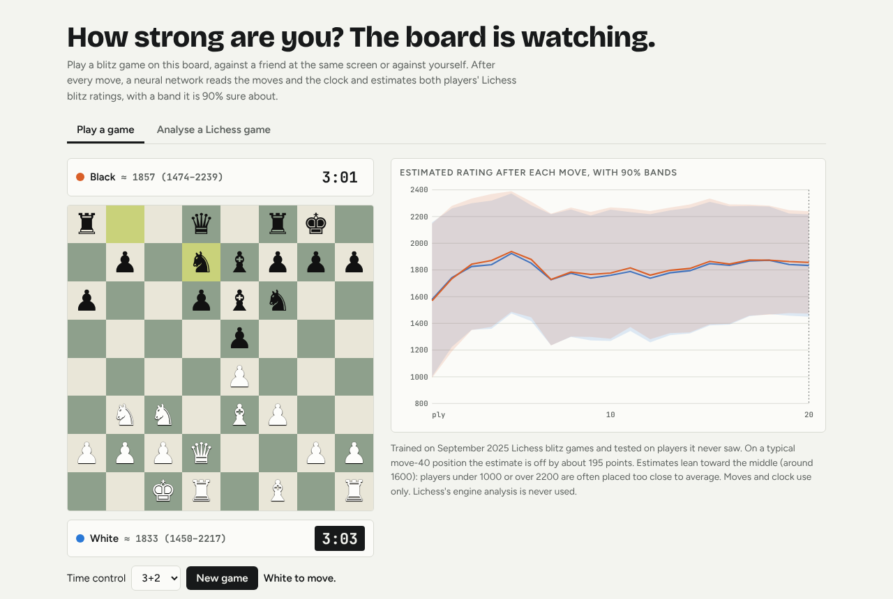
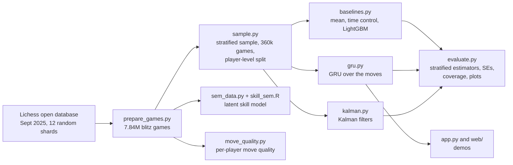
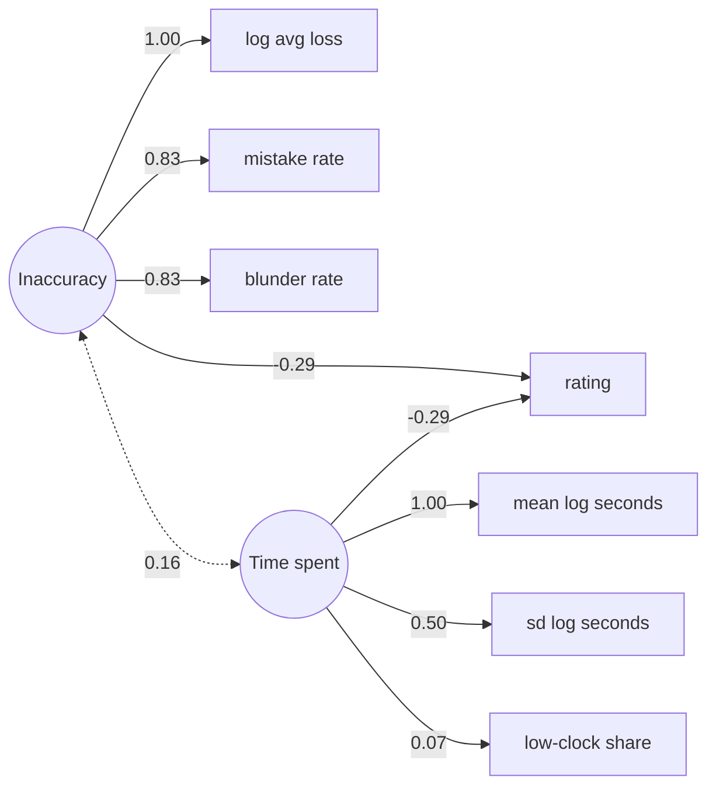
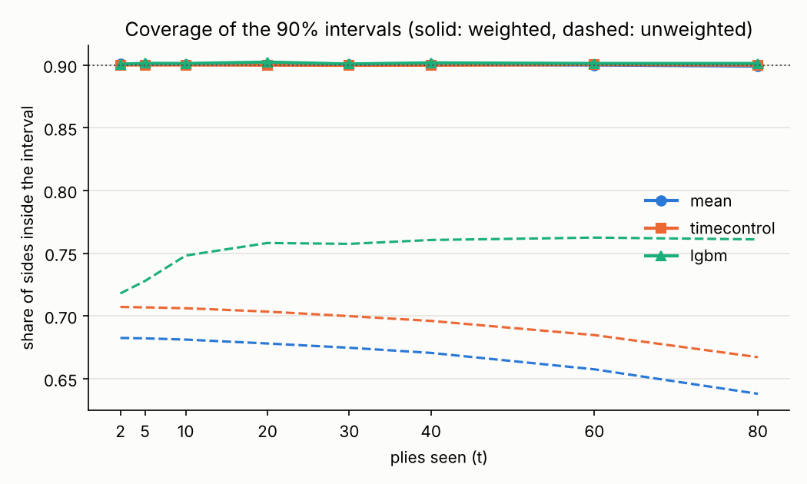
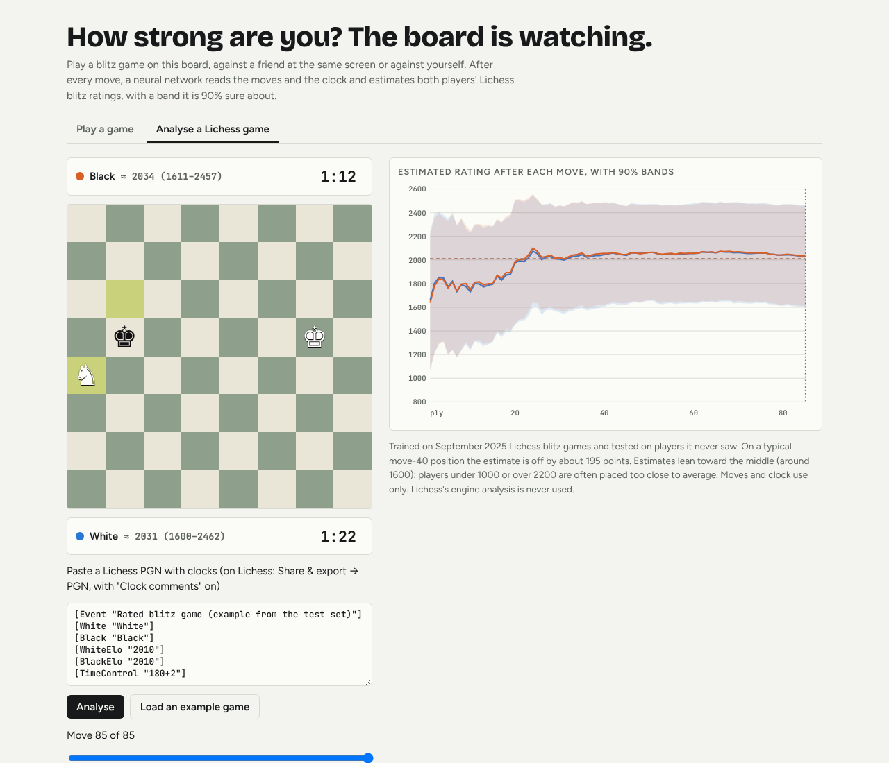
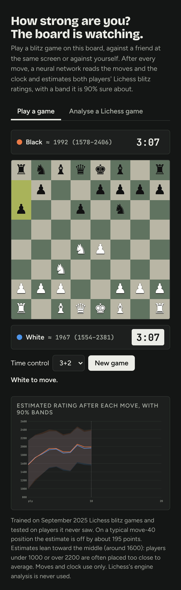
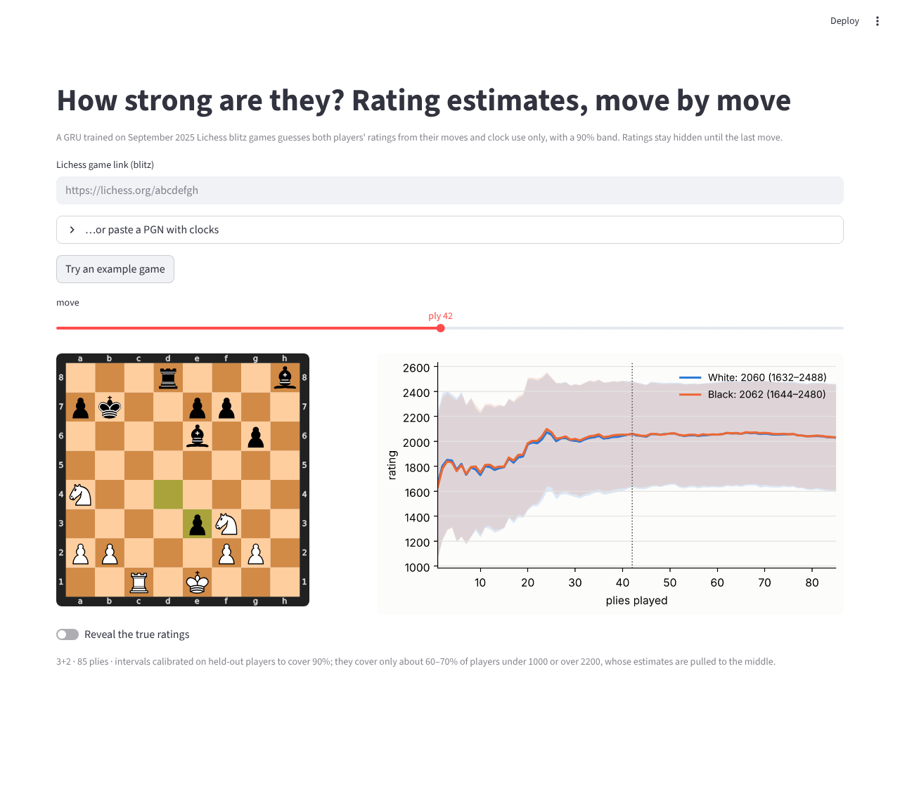

# Reading chess ratings from the moves

How strong are the two players in a blitz game, judged only by the moves they make and the time they spend? This project estimates both players' Lichess blitz ratings after every move, with a 90% interval that narrows as the game goes on. It was built in six phases: one shared backbone (features, baselines, evaluation) and five phases that each apply one course from a statistics master's year: Sampling Theory, Data Mining and Neural Networks, Advanced Time Series Analysis, Structural Equations, and Data Visualization in Data Science.

Ratings here are Lichess Glicko-2 blitz ratings, not FIDE Elo.



**Try it:** [Blitz Rating Reader](https://claude.ai/artifact/FdDzG4FNMxNBzUcJvn7V8v). Play a blitz game on a real clock and watch the estimates move, or paste a Lichess game. The link is private until its owner shares it from the page's Share menu. Or analyse any Lichess game in the [Streamlit app](https://chess-rating-reader.streamlit.app/).

## Results at a glance

On players the models never saw in training, weighted to represent a whole month of Lichess blitz:

| | after 2 plies | after 20 plies | after 80 plies |
|---|---|---|---|
| Error of the best model (GRU), rating points | 276 | 207 | 188 |
| Its 90% interval | ±563 | ±422 | ±379 |
| Share of players inside that interval | 0.90 | 0.90 | 0.89 |
| Error of LightGBM on summary features | 281 | 256 | 252 |
| Error of guessing the time control's average | 283 | 282 | 280 |

- **One game reveals the level of the game.** A recurrent neural network (GRU) that reads the moves and the clock is off by about 195 points after 40 plies (20 moves each) and 188 after 80, 65 points better than a strong tabular model, with intervals that are calibrated on held-out players.
- **One game barely reveals the gap between the two players.** Lichess pairs players of similar strength, and the GRU learns mostly the pair's shared level: when the two ratings differ by more than 200 points, it gives the higher estimate to the stronger player only 52–58% of the time (55–58% from ply 5 on). Models that look at each player separately do better (about two times in three), but none comes close to reliable. [Details below](#can-it-tell-the-two-players-apart).
- **Estimates are pulled toward the middle.** Players under 1000 are overrated and players over 2200 underrated by over 300 points even after 80 plies.
- **Skill has two nearly independent parts.** In a structural equation model, move inaccuracy (loss per move) and thinking time each predict rating about equally (β = −0.29 each: players who lose less per move and move faster are rated higher), and the two correlate only 0.16.

## The pipeline



Every model in the comparison (the baselines, the GRU and the Kalman filters) writes its predictions in the same format (game, side, plies seen, mean, 90% interval), and `evaluate.py` scores them all the same way; the move-quality experiment is scored in `move_quality.py`.

## Methods by course

| Course | What it answers here | Methods used | Code |
|---|---|---|---|
| Sampling Theory | How to draw a sample whose results describe a whole month, and how sure we can be | cluster sampling of shards, stratified sampling with an outcome-defined stratifier, design weights N_h/n_h, domain estimation, stratified estimator with finite-population correction, player-cluster bootstrap, delete-one-shard jackknife, Hájek ratio estimates | `download.py`, `sample.py`, `split.py`, `evaluate.py` |
| Data Mining and Neural Networks | How well the moves predict the ratings | feature engineering, gradient boosting (LightGBM), GRU with move embeddings, heteroscedastic Gaussian likelihood, early stopping, learning-rate decay, gradient clipping, split conformal prediction, leakage checks, ablation | `features.py`, `baselines.py`, `gru.py` |
| Advanced Time Series Analysis | Whether "evidence accumulating move by move" can be modelled classically | state-space models, the Kalman filter as precision-weighted averaging, AR(1) measurement errors by state augmentation, autocorrelation diagnostics | `kalman.py` |
| Structural Equations | Whether skill splits into accuracy and time use, and whether that holds across time controls | confirmatory factor analysis, structural regression, robust ML (MLR), fit indices, Heywood cases, measurement invariance (configural, metric, scalar) | `sem_data.py`, `skill_sem.R` |
| Data Visualization in Data Science | How to show estimates and their uncertainty so anyone gets it | uncertainty bands, calibration (coverage) plots, a colour-blind-checked palette, direct labelling, light and dark themes, interactive demos | `evaluate.py`, `app.py`, `web/` |

Each course is described below.

## 1. Sampling Theory: data and sampling design

**Population.** The target is every rated blitz game on Lichess in September 2025 (blitz by Lichess's own rule: base time + 40 × increment between 180 and 479 seconds). The games come from the [Lichess open database](https://database.lichess.org) (CC0), via its Parquet version on Hugging Face, [Lichess/standard-chess-games](https://huggingface.co/datasets/Lichess/standard-chess-games), pinned to one revision.

**Cluster sample of shards.** The month is split into 62 Parquet shards that are probably consecutive time chunks, so the first few would all come from the same days. `download.py` draws 12 at random (seed 0), a cluster sample of the month. `prepare_games.py` keeps blitz games and drops games with a bot or a move without a clock: 7,840,050 games. Per game it keeps the players, ratings, opening code, time control, moves, the clock after each move, and the engine evaluation after each move where Lichess analysed the game.

**Stratified sample.** Ratings pile up between 1400 and 2000, so a simple random sample would leave the weakest and strongest players, where models struggle most, with few games. `sample.py` stratifies on 200-point bands of the two players' mean rating (9 strata) and draws up to 40,000 games per stratum: 360,000 games. Each game carries the weight N_h/n_h, from 1.85 (2400+) to 41.3 (1600–1799).

**Why the weights matter everywhere.** The stratifier is built from the very ratings being predicted, so the sample is not representative of the month even within a time control. An unweighted model would learn the sample's rating mix. So every model is fitted with the weights, and every reported number is weighted back to the month. Unweighted, the same GRU predictions look quite different (error 250–411 instead of 188–276 points, coverage 0.71–0.79 instead of 0.89–0.90), because the sample oversamples the rating tails, where errors are largest.

**Player-level split.** Each username is hashed to train, val or test (80/10/10). A game is test if either player is a test player, else val if either is a val player, else train. A side is scored only if its player belongs to the game's split, so every test error and coverage number comes from players never seen in training (the two-player gap metrics, described below, use both sides of each test game). An assertion checks that none of the 28,482 scored test players appears in any of the 5.03 million train games.

**Estimation (`evaluate.py`).**
- **Stratified estimator.** The unit is a test game, valued by the mean error over its scored sides. Strata are weighted by N_h(t)/N(t), where N_h(t) counts the games in `games/` (the 12 downloaded shards, 7.84 million games) that reach t plies. The test games are a domain of the sample, so the finite-population correction uses the whole sample's fraction.
- **Three standard errors.** `se` treats test games as independent. `se_player` resamples whole test players within strata (a cluster bootstrap), because one player's errors move together; it is 1.0–1.6 times larger (about 1.2–1.6 for the baselines and Kalman filters, but only 1.0–1.3 for the GRU). `se_shard` deletes one downloaded shard at a time (a JK1 jackknife), because shards are the first-stage clusters. All three stay under 1.2 rating points for the MAE.
- **Ratio estimates by rating band.** `metrics_by_band.csv` gives bias, error and coverage per band of a player's own rating, as weighted (Hájek) means.
- **A fixed cohort.** At larger t only longer games remain, so the curves mix "more information" with "different games". `weighted_mae_80` follows only the games that reach ply 80.

## 2. Data Mining and Neural Networks: baselines and the GRU


**Baselines (`baselines.py`).**
- `mean` and `timecontrol` predict the month's average rating, overall or per time control.
- `lgbm` is LightGBM on per-side summaries after t plies (`features.py`): moves made, mean and sd of log seconds per move, share of moves under 2 seconds, clock left as a share of base time, time control, berserk, and the opening family from ply 10 on (Lichess sets the opening code from later moves, so earlier it would leak the future), plus, for games Lichess analysed, a has-evals flag and the side's average loss, mistakes and blunders from the engine evaluations (the post-game information later dropped from the GRU).
- Intervals are split conformal: the weighted 90% quantile of absolute residuals on validation players, per checkpoint.

LightGBM improves from 281 points at ply 2 to 256 by ply 20 and then stalls at 252: per-side summaries say most of what they can by move 10.

**The GRU (`gru.py`).** A recurrent network reads the game one ply at a time. Its inputs per ply:
- the move itself, as a learned embedding of the 3,126 moves (in algebraic notation) seen at least 20 times in train;
- the mover's log seconds spent and clock left as a share of base;
- base time and increment.

After every ply it outputs a mean and a log-variance for both players' standardised ratings. It is trained on the Gaussian negative log-likelihood, so it learns its own uncertainty (heteroscedastic regression), weighted by N_h/n_h. One GRU layer of 128 units (277k parameters, 1.2 MB) trains in 15 minutes on 4 CPUs, with cosine learning-rate decay, gradient clipping and early stopping on validation likelihood (epoch 4 of 6). Its 90% intervals are mean ± q·sd, with q calibrated per checkpoint on validation players (split conformal on |error|/sd): q runs from 1.61 to 1.72, close to the Gaussian 1.645.

| plies seen | LightGBM error | GRU error | LightGBM interval score | GRU interval score | GRU interval | GRU coverage |
|---|---|---|---|---|---|---|
| 2 | 281 | 276 | 1390 | 1387 | ±563 | 0.90 |
| 10 | 263 | 226 | 1311 | 1148 | ±461 | 0.90 |
| 20 | 256 | 207 | 1283 | 1067 | ±422 | 0.90 |
| 80 | 252 | 188 | 1277 | 978 | ±379 | 0.89 |

Errors are weighted MAE in rating points. The interval score is the width plus 20 times any miss (lower is better), so a narrow interval only pays if it still covers.

- **The GRU wins at every checkpoint**, by 5 points at ply 2, 49 by ply 20 and 65 by ply 80, and its interval score is 23% better by ply 80. The GRU reads the moves themselves and the full sequence of move times, where LightGBM gets only per-side summaries; no ablation separates the two sources of the gain.
- **The gain comes from more information, not from different games.** On the fixed cohort of games that reach ply 80, its error still falls from 272 at ply 2 to 188 at ply 80.


**Leakage check and ablation.** A first GRU (`gru_v1`) also read Lichess's engine evaluations. Those exist only for games someone asked to have analysed after the game ended, so even their absence reveals a later event, and a live game never has them. Dropping them costs nothing where it matters:

| weighted error | with engine evals (gru_v1) | without (gru) |
|---|---|---|
| all test games, ply 20 / 80 | 206 / 187 | 207 / 188 |
| games without evals, ply 20 / 80 | 204 / 185 | 204 / 185 |
| coverage on games without evals, ply 80 | 0.89 | 0.90 |
| games with evals, ply 20 / 80 | 228 / 204 | 239 / 222 |

`gru` (no evals) is the chosen model and the one in the demos. Each version was trained once, so differences of a point or two are within what a reseed could move.

## 3. Advanced Time Series Analysis: Kalman filters

`kalman.py` treats a player's rating as a constant hidden state and updates it once per own move: the classical version of "the estimate sharpens as evidence arrives".
- **Prior:** the time control's mean rating and the spread of ratings within it.
- **Observation per move:** z, a LightGBM prediction of the mover's rating from that one move's seconds spent, clock left and ply, trained on 2 million moves and taken as z = rating + error.
- **Noise:** the error's sd, from validation residuals, is 338–365 points per move, about the spread of ratings within a time control (350). One move says little.
- **`kalman_iid`** assumes independent errors. The filter is then precision-weighted averaging of the prior and the observations.
- **`kalman_ar1`** gives the errors AR(1) correlation between a player's consecutive moves (ρ = 0.979, estimated from validation residuals) by adding the current error to the state.

Both use model-based Gaussian intervals on purpose, to test whether each model's own uncertainty is honest.


| plies seen | iid error | iid coverage | iid interval | AR(1) error | AR(1) coverage | AR(1) interval |
|---|---|---|---|---|---|---|
| 2 | 285 | 0.75 | ±415 | 285 | 0.75 | ±415 |
| 10 | 275 | 0.49 | ±233 | 277 | 0.74 | ±396 |
| 20 | 269 | 0.38 | ±170 | 274 | 0.74 | ±389 |
| 80 | 274 | 0.20 | ±90 | 273 | 0.71 | ±365 |

- **Independent errors are badly overconfident.** Every move counts as fresh evidence, so the interval shrinks to ±90 while the error stays near 270, and only 20% of players fall inside by ply 80.
- **AR(1) errors fix most of it.** The interval barely shrinks and coverage holds at 0.71–0.75.
- **What remains:** the residual autocorrelation is still 0.958 at lag 10, where AR(1) implies 0.806. So the errors behave like a fixed offset per player, and even AR(1) forgets them too fast. Coverage is also only 0.75 after one move, because the per-move prediction and the prior are both pulled toward the average, so their errors are shared and counted twice.
- **On error** the filters (269–285) sit near the time-control baseline, far from the GRU, which reads whole sequences of moves.

## 4. Structural Equations: is skill one thing?

`sem_data.py` takes every game Lichess analysed in the 12 shards and keeps one random game per player, with at most one player per game, so the 342,000 rows are independent. Per player-game:
- **inaccuracy indicators:** log average loss in pawns, mistake rate (loss ≥ 1 pawn) and blunder rate (≥ 3 pawns);
- **time-use indicators:** mean and sd of log seconds per move, and the share of moves made with under 10% of base time left.

`skill_sem.R` (R, lavaan, robust maximum likelihood) fits two factors and regresses rating on both. Standardised estimates:



| n | scaled χ² (df) | CFI | TLI | RMSEA | SRMR | R² of rating |
|---|---|---|---|---|---|---|
| 342,000 | 53,500 (14) | 0.944 | 0.916 | 0.110 | 0.056 | 0.19 |

- **Two skills, nearly independent, equally tied to rating.** Players who lose less per move and players who move faster are both higher rated (β = −0.29 each); the factors correlate 0.16 and together explain 19% of rating variance.
- **"Time use" is really thinking time.** The low-clock share hardly loads (0.07), so time trouble is a different thing.
- **Fit is moderate** (CFI 0.94, RMSEA 0.11 above the usual 0.08).
- **Heywood cases.** Left free, the residual variances of log average loss and mean log seconds come out negative, so they are fixed at 0 (loading 1.00). Average loss is nearly the sum of mistakes and blunders, and the time indicators barely correlate.

**Measurement invariance across the three most common time controls** (3+0, 5+0, 3+2):

| model | scaled χ² (df) | CFI | RMSEA | SRMR | ΔCFI |
|---|---|---|---|---|---|
| configural | 31,589 (30) | 0.951 | 0.114 | 0.047 | |
| metric (equal loadings) | 30,391 (38) | 0.950 | 0.102 | 0.048 | −0.001 |
| scalar (+ equal intercepts) | 41,707 (46) | 0.933 | 0.108 | 0.065 | −0.017 |

Equal loadings hold (ΔCFI −0.001, within the usual 0.01): the factors mean the same in each time control. Equal intercepts do not (−0.017): at the same latent level, raw time use differs with the clock, so factor means should not be compared across time controls. Only analysed games are used (about 9% of the month), and players who request analysis are not a random subset.

## 5. Data Visualization in Data Science: figures and demos

**Figures.** Every chart shows uncertainty, not just a point: error with ±1.96 SE bands, interval width, and coverage against the 0.90 target, with unweighted coverage dashed to show why the weights matter. The six model colours pass a palette validator's checks for lightness, chroma and colour-blind separation (the weakest neighbouring pair is 9.1 ΔE for red-green colour blindness and 5.8 for blue-yellow), so every line also has its own marker shape. Colours below 3:1 contrast against the background are backed by direct line labels (on the coverage plot, where the weighted lines all sit on 0.90, by a one-row legend with the marker shapes instead), end labels are spaced so they never overlap, and `metrics.csv` is the table view of every plot.



**The web demo** (`web/`, published as [Blitz Rating Reader](https://claude.ai/artifact/FdDzG4FNMxNBzUcJvn7V8v)) runs the chosen GRU in the browser:
- **Play a game:** both sides on one board, on a real blitz clock (3+0, 3+2, 5+0, 5+3) that starts after both first moves and adds the increment, as on Lichess. After every move both estimates and bands update.
- **Analyse a Lichess game:** paste a PGN exported with clock comments, step through it with a slider, and see the true ratings at the last move.
- `export_web.py` writes the weights to JSON, `web/model.js` ports the per-ply inputs and the GRU step to JavaScript, and `test_web.py` checks under Node that the browser's numbers match Python's to within 0.5 rating points.
- It follows the viewer's light or dark theme and works at phone width.

<p>


</p>

**The Streamlit app** (`app.py`) is the same model in Python: paste a Lichess link or PGN, or try the built-in example. It is live at [chess-rating-reader.streamlit.app](https://chess-rating-reader.streamlit.app/). Run it locally with `streamlit run app.py`, or deploy your own copy at [share.streamlit.io](https://share.streamlit.io) (repo, branch `main`, `app.py`, Python 3.13); `requirements.txt` already uses CPU-only torch.




## Can it tell the two players apart?

Playing the demo shows a real weakness: the two estimates move almost together, even when one player is much stronger. The question here is not "how strong is this game" but "who is the stronger of the two, and by how much".

**Measured on the 68,464 test games, at each ply on those that reach it** (65,973 at ply 20, 56,539 at 40 and 22,881 at 80; 2,613, 2,232 and 915 of them with a gap over 200) (`metrics.csv`: `stronger_found` and `gap_corr`, weighted to the month): the share of games with a true gap over 200 points where a model gives the higher estimate to the stronger player, and in brackets the correlation r between predicted and true gaps. A coin flip scores 0.50.

| plies seen | GRU | LightGBM | Kalman (iid) | Kalman (AR(1)) |
|---|---|---|---|---|
| 20 | 0.56 (r = 0.05) | 0.66 (r = 0.14) | 0.66 (r = 0.17) | 0.65 (r = 0.10) |
| 40 | 0.55 (r = 0.04) | 0.66 (r = 0.13) | 0.67 (r = 0.16) | 0.61 (r = 0.08) |
| 80 | 0.56 (r = 0.04) | 0.63 (r = 0.12) | 0.66 (r = 0.15) | 0.58 (r = 0.06) |

These use both sides of every test game, not only unseen players: games with two unseen players are too few (156 with a gap over 200), and no model is told who is playing, so a training player on one side of a test game gives nothing away.

**Why the GRU fails here.** Lichess pairs players of similar strength: 87% of games are within 100 points and only 4% differ by more than 200. One hidden state reads the whole game, so the cheapest way for the GRU to score well is to estimate the pair's shared level and give both players nearly the same number. LightGBM and the iid Kalman filter build each player's estimate from that player's own moves and clock only, and they separate the two clearly better (0.63–0.67), though the correlation with the true gap stays at 0.17 or below from ply 20 on.

**An experiment: judge each player only by the quality of their own moves** (`move_quality.py`). From the train players' games among the roughly 700,000 games Lichess analysed (30.3 million moves), it learns how often players of each rating lose a given amount on a move, in seven sizes from near-best (under 0.05 pawns) to big blunders (over 4), in the opening, middlegame and endgame. Each player starts from the rating distribution of train players in analysed games, and every move updates only the mover's estimate, by how likely that move's quality is at each rating. A good move raises only the mover and the gap can grow. Each move counts as a fraction of independent evidence (the likelihood is tempered), with the fraction set on validation players so the 90% intervals cover 90%.

| plies seen | move quality, all analysed test games | games with gap > 200 | move quality, games shared with the GRU | GRU, same games | games with gap > 200 |
|---|---|---|---|---|---|
| 20 | 0.62 (r = 0.12) | 12,054 | 0.63 (r = 0.11) | 0.56 (r = 0.04) | 623 |
| 40 | 0.62 (r = 0.13) | 11,029 | 0.64 (r = 0.13) | 0.54 (r = 0.02) | 573 |
| 80 | 0.59 (r = 0.10) | 3,149 | 0.61 (r = 0.11) | 0.54 (r = 0.01) | 209 |

On the same games, judging moves by quality finds the stronger player about 61–64% of the time against 54–56% for the GRU, about as well as the per-side models above. Its error per player is larger (304–318 points on analysed test games from ply 20 on), because move quality alone says less about a player's level than the moves themselves. It uses Lichess's own deep engine analysis, which a live game does not have, so it is not in the demo.

**What this means.** A single blitz game pins down the level of the game well, and the gap between the two players only weakly: about 40 moves each, everyone makes some mistakes, and the clock and move quality vary with the position. Two ways forward: combine the GRU's level with a per-side model's gap, and, to separate players reliably, use several games per player rather than one.

## Limitations

- **Pulled toward the middle.** The GRU at ply 80, by the player's own rating (`results/metrics_by_band.csv`):

  | own rating | bias | error | coverage |
  |---|---|---|---|
  | under 1000 | +341 | 342 | 0.67 |
  | 1000–1399 | +203 | 229 | 0.85 |
  | 1400–1799 | +33 | 148 | 0.95 |
  | 1800–2199 | −131 | 170 | 0.93 |
  | 2200+ | −329 | 330 | 0.64 |

  With one game's evidence the best guess leans toward the typical player. Calibration promises 90% coverage on average, not for each true rating.
- **The two players are only weakly told apart** (above): about two times in three at best when they differ by more than 200 points.
- **One month only.** The dataset stops at September 2025, so drift to later months is untested.
- **One training run per model**, so run-to-run variation is not measured.
- **The GRU is trained on the first 200 plies** (99.9% of games).
- **`se_shard` has only 11 degrees of freedom.**

## Repository layout

| File | What it does |
|---|---|
| `download.py`, `prepare_games.py` | fetch 12 random shards (pinned revision); parse games, clocks and evals |
| `split.py`, `sample.py` | player-level split; stratified sample with weights |
| `features.py`, `baselines.py` | per-side features; mean, time-control and LightGBM baselines |
| `gru.py`, `model.pt` | the GRU and its trained weights |
| `kalman.py` | the two Kalman filters |
| `evaluate.py` | one scorer for every `results/preds_*.parquet` model; writes `results/metrics*.csv` and the figures (the move-quality experiment scores itself, unweighted, in `move_quality.py`) |
| `sem_data.py`, `skill_sem.R` | data and model for the latent skill SEM |
| `move_quality.py` | the per-player move-quality experiment |
| `demo.py`, `app.py` | the Streamlit demo ([live](https://chess-rating-reader.streamlit.app/)) |
| `export_web.py`, `web/` | the in-browser demo |
| `test_*.py` | tests (pytest), run by GitHub Actions on every push |
| `PLAN.md`, `CLAUDE.md` | the phase plan and the project conventions |

## Reproduce

```
pip install -r requirements.txt
python download.py                     # 12 shards, about 11 GB
python prepare_games.py games lichess/data/year=2025/month=09/*.parquet
python sample.py games
python baselines.py
python gru.py 20000                    # quick check on 20,000 train games that the loss falls
python gru.py                          # about 15 minutes on 4 CPUs
python kalman.py
python evaluate.py
python sem_data.py
Rscript skill_sem.R                    # needs R with lavaan, e.g. apt-get install r-base-core r-cran-lavaan
python move_quality.py
python export_web.py
streamlit run app.py
pytest
```

Package versions and the dataset revision are pinned. Data files are not committed; the code, trained weights and small results (CSV, PNG) are.

Data: Lichess open database, CC0.
