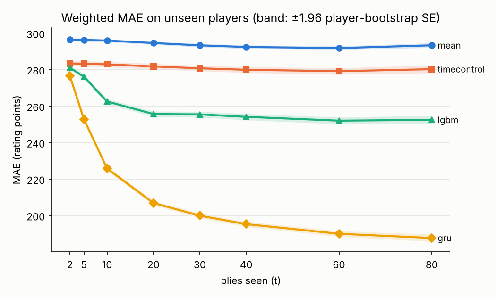
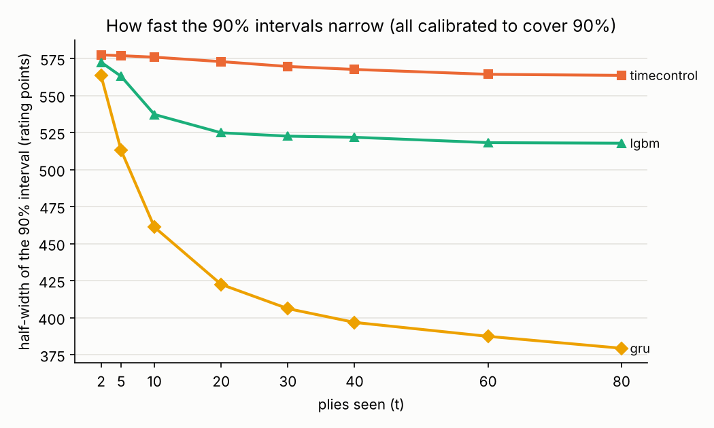
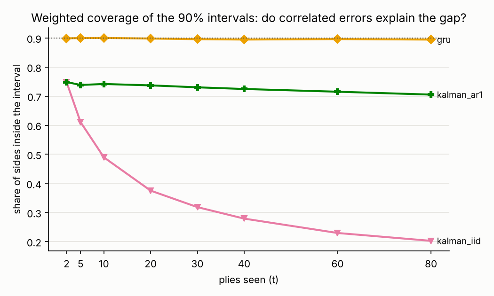
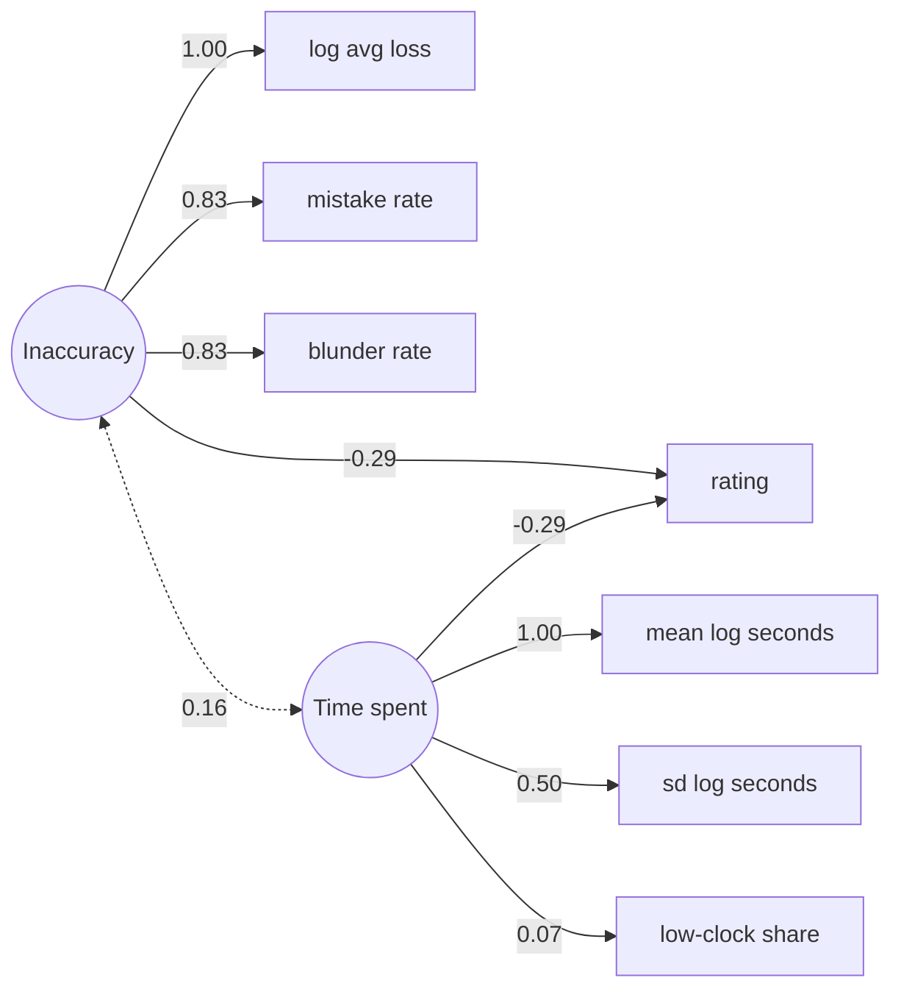
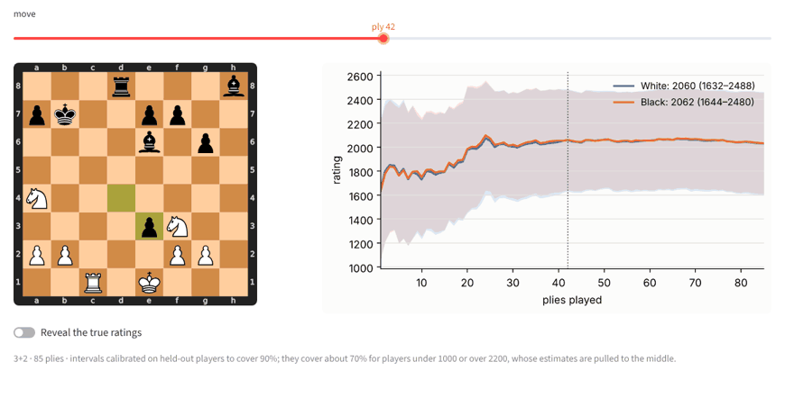

# Predicting chess ratings move by move

Predicts both players' Lichess blitz ratings after every move, with 90% intervals that should narrow as the game goes on. Ratings are Lichess Glicko-2 ratings, not FIDE Elo. [PLAN.md](PLAN.md) builds it in phases, each applying one course.

## Status

- [x] Phase 1 — Data, stratified sample, player split (Sampling Theory)
- [x] Phase 2 — Features, baselines, evaluation
- [x] Phase 3 — GRU sequence model (Data Mining and Neural Networks)
- [x] Phase 4 — State-space filter (Advanced Time Series Analysis)
- [x] Phase 5 — Latent skill model (Structural Equations)
- [ ] Phase 6 — Figures and demo app (Data Visualization in Data Science)

## Data

Rated games from the [Lichess open database](https://database.lichess.org) (CC0), via its Parquet version on Hugging Face, [Lichess/standard-chess-games](https://huggingface.co/datasets/Lichess/standard-chess-games).

- `download.py` fetches 12 random shards of September 2025 (seed 0). Shards are probably consecutive time chunks, so random ones make a cluster sample of the month.
- `prepare_games.py` keeps blitz games by Lichess's own definition (base time + 40 × increment between 180 and 479 seconds) and drops games with a bot or a move missing its clock. Per game: players, ratings, ECO, time control, SAN moves, the mover's clock after each move, and the engine eval after each move where Lichess analysed the game.
- `sample.py` draws up to 40 000 games per 200-point band of the players' mean rating, with weight N_h / n_h, and splits players into train/val/test (80/10/10) so test results come only from unseen players.

## Results





### Baselines

LightGBM on clock, time-control, opening and (where Lichess analysed the game) engine-loss features gets from 281 rating points of error at ply 2 (no better than the time control alone) to 256 by ply 20, then only to 252 by ply 80, while the `mean` and `timecontrol` baselines stay near 293 and 280. So most of what these per-side summaries can tell is known by move 10, and the 90% intervals are still about ±520 points wide ([coverage](results/coverage.png), [all numbers](results/metrics.csv)).

At larger t only longer games remain (about a third of test sides reach ply 80), so the curves mix "more information" with "different games": `mean` predicts the same number at every t, yet its error moves by 5 points. `weighted_mae_80` removes that by following only the games that reach ply 80.

- `features.py` summarises one side after t plies: own moves, log seconds spent per move (mean, sd, share under 2 s), clock left as a share of base, base, increment, berserk, first ECO letter and, when evals exist, average loss, mistakes (≥ 1 pawn) and blunders (≥ 3). ECO is hidden before ply 10, because Lichess sets it from moves played later.
- Only 9% of the month's games have evals (14% of the sample), and analysed games are not a random subset, so the model gets `has_evals` as a feature rather than treating missing evals as random.
- `baselines.py` weights every fit by N_h / n_h, since the strata are bands of the outcome itself. Intervals are split conformal: the weighted 90% quantile of absolute val residuals per t.
- `evaluate.py` reports plain `mae` and `coverage` over the sample, and `weighted_mae` / `weighted_coverage` for the month. The weighted versions use the stratified estimator over test games, with N_h(t) counted in `games/`. The plain ones look much worse (MAE 350–470, coverage 0.64–0.76) because the sample oversamples the rating tails. `se` treats test games as independent. `se_player` resamples whole test players within strata and is 1.2–1.6 times larger. The plot's bands use `se_player`. `se_shard` deletes one downloaded shard at a time, since the 12 shards are a random sample of the month's 62. `interval_score` (width plus 20 times any miss) ranks intervals with one number.

### GRU

`gru.py` reads the game one ply at a time. Each ply's inputs:
- the move, as an embedding of the 3,126 SAN moves seen at least 20 times in train;
- the mover's log seconds spent and clock share;
- base and increment.

After every ply it outputs a mean and log-variance for both players' standardised ratings. It is trained on the Gaussian NLL weighted by N_h / n_h, like the baselines, with a cosine learning-rate decay. The model is one GRU layer of 128 units (279k parameters; `model.pt` is 1.2 MB). Training took 15 minutes on 4 CPUs, and early stopping on val NLL kept epoch 4 of 6. The 90% intervals are mean ± q·sd, where q is calibrated per t on val sides (split conformal on |error| / sd). q runs from 1.61 to 1.72; a plain Gaussian would use 1.645.

| plies seen | lgbm MAE | GRU MAE | lgbm interval score | GRU interval score | GRU interval | GRU coverage |
|---|---|---|---|---|---|---|
| 2 | 281 | 276 | 1390 | 1387 | ±564 | 0.90 |
| 10 | 263 | 226 | 1311 | 1148 | ±469 | 0.90 |
| 20 | 256 | 207 | 1283 | 1067 | ±428 | 0.90 |
| 80 | 252 | 188 | 1277 | 978 | ±382 | 0.89 |

All columns are weighted to the month. The interval score is the width plus 20 times any miss, so lower is better. Standard errors of the MAE stay under 1.2 points, by player bootstrap and by shard jackknife alike.

The GRU wins at every checkpoint, and the gap grows as the game goes on: 5 points at ply 2, 49 by ply 20 and 65 by ply 80. On interval score it is about level with lgbm at ply 2, then 23% better by ply 80.

The gap comes from the moves themselves, which lgbm never sees: it only gets per-side summaries and the ECO letter from ply 10. So the comparison mixes "sequence model vs table" with "moves vs no moves".

Following the same games all the way removes the "only longer games remain" effect. The GRU's MAE on games that reach ply 80 still falls, from 272 at ply 2 to 188 at ply 80 (`weighted_mae_80`). The gain comes from seeing more plies, not from the mix of games changing.

**Why this GRU and not the first one.** The first GRU (`gru_v1` in the CSVs) also read engine evals. They are a problem for two reasons. Lichess has evals only for games someone had analysed after the game ended, so even their absence reveals a later event. And a live game never has them. The two versions compare like this (weighted MAE):

| | gru_v1 (with evals) | gru (no evals) |
|---|---|---|
| all test games, ply 20 / 80 | 206 / 187 | 207 / 188 |
| games without evals, ply 20 / 80 | 204 / 185 | 204 / 185 |
| coverage on games without evals, ply 80 | 0.89 | 0.90 |
| games with evals, ply 20 / 80 | 228 / 205 | 239 / 225 |

On games without evals, which is every live game, the two are equal, and the new one is better calibrated. The evals only help on the 9% of games that have them. `gru` is the best model so far and the one the demo will use.

Each version was trained once, and the new run also changed the learning-rate schedule, so differences of a point or two are within what a reseed might move.

### Kalman filters

`kalman.py` treats a player's rating as a constant hidden state and updates it once per own move. It is a classical model of "the estimate sharpens as evidence arrives", set against the GRU.
- **Prior:** the time control's weighted mean rating and the variance of ratings within it.
- **Observation per move:** z, a per-move LightGBM prediction of the mover's rating from seconds spent, clock left and ply. It was trained on 2 million random train moves and is taken as z = rating + e, as PLAN.md specifies.
- **Noise:** var(e) per ply bin comes from val residuals: σ = 338–365 points. That is about the spread of ratings within a time control (350), so a single move says little.
- **Errors:** `kalman_iid` assumes they are independent. `kalman_ar1` gives them AR(1) correlation between a player's consecutive moves, ρ = 0.979, estimated from val residuals. Its state is augmented with the current error.

Both use model-based Gaussian intervals (mean ± 1.645 sd), so the plot below shows whether each model's own uncertainty is honest.



| plies seen | iid MAE | iid coverage | iid interval | AR(1) MAE | AR(1) coverage | AR(1) interval | GRU MAE | GRU coverage |
|---|---|---|---|---|---|---|---|---|
| 2 | 285 | 0.75 | ±415 | 285 | 0.75 | ±415 | 276 | 0.90 |
| 10 | 275 | 0.49 | ±233 | 277 | 0.74 | ±396 | 226 | 0.90 |
| 20 | 269 | 0.38 | ±170 | 274 | 0.74 | ±389 | 207 | 0.90 |
| 80 | 274 | 0.20 | ±90 | 273 | 0.71 | ±365 | 188 | 0.89 |

**Does modelling the error correlation fix the overconfidence? Mostly.** With independent errors, every move counts as fresh evidence. So kalman_iid's interval shrinks to ±90 by ply 80 while its error stays near 270, and coverage collapses to 0.20. With AR(1) errors the interval barely shrinks, and coverage holds at 0.70–0.74.

**Two things still keep it below 0.90:**
- **The errors behave like a fixed offset per player, not like AR(1).** The residual autocorrelation is still 0.958 at lag 10, where AR(1) with ρ = 0.979 implies 0.806. So even the AR(1) filter forgets old errors too fast, and coverage drifts down from 0.74 to 0.71.
- **Coverage is only 0.75 already at ply 2,** where both filters have seen one move and are identical. A per-move prediction is pulled toward the average rating, and so is the prior. Their errors therefore move together, while the filter treats them as independent and counts the shared part twice.

Two fixes would follow, neither done here: model the error as a persistent offset plus noise, and calibrate z against the true rating (z = a + b·rating + e) instead of taking it as unbiased.

On error the filters (269–285) sit near `timecontrol` and behind lgbm, far from the GRU, which reads the moves themselves rather than one move's clock use at a time.

### Latent skill (SEM)

Does skill split into accuracy and time use? `sem_data.py` takes every game Lichess analysed in the 12 shards and keeps one random game per player, with at most one player per game, so the rows are independent: 342,000 player-games. Per player-game it records:
- **Accuracy indicators:** log average loss, mistake rate (loss ≥ 1 pawn) and blunder rate (≥ 3 pawns). Higher means *less* accurate.
- **Time-use indicators:** mean and sd of log seconds per move, and the share of moves made with under 10% of base time left.

`skill_sem.R` (lavaan, MLR) fits two factors and regresses rating on both. Standardised estimates:



| n | scaled χ² (df) | CFI | TLI | RMSEA | SRMR | R² of rating |
|---|---|---|---|---|---|---|
| 342,000 | 53,500 (14) | 0.944 | 0.916 | 0.110 | 0.056 | 0.19 |

**What it says:**
- **Two skills, each tied to rating about equally and nearly independently.** Players who lose less per move and players who move faster are both higher rated: β = −0.29 each, and the two factors correlate only 0.16. Together they explain 19% of the variance in rating.
- **"Time use" is really one indicator: how long you think.** Low-clock share hardly loads on it (0.07), so time trouble is a different thing from thinking time.
- **Fit is only moderate.** CFI is 0.94, and RMSEA 0.11 is above the usual 0.08.
- **Two loadings are fixed at 1.00.** Left free, the residual variances of log average loss and mean log seconds come out negative (Heywood cases), so they are fixed at 0. Average loss is nearly the sum of mistakes and blunders, and the three time indicators barely correlate (0.07–0.50).

**Measurement invariance across the three most common time controls** (3+0, 5+0, 3+2):

| model | scaled χ² (df) | CFI | RMSEA | SRMR | ΔCFI |
|---|---|---|---|---|---|
| configural | 31,589 (30) | 0.951 | 0.114 | 0.047 | |
| metric (equal loadings) | 30,391 (38) | 0.950 | 0.102 | 0.048 | −0.001 |
| scalar (+ equal intercepts) | 41,707 (46) | 0.933 | 0.108 | 0.065 | −0.017 |

Equal loadings hold (ΔCFI −0.001, within the usual 0.01), so the factors mean the same thing in each time control. Equal intercepts do not (−0.017): at the same latent level, a 3+0 player shows different raw time use than a 5+0 player, as expected when the clock differs. Comparing factor *means* across time controls would therefore not be valid.

**Caveat:** only analysed games are used (about 9% of the month), and players who request analysis are not a random subset.

## Demo



`app.py` (Streamlit) takes a Lichess blitz game link, or a PGN with clocks, or a built-in example game from the test set. It runs the chosen GRU (`model.pt`, no evals) over every ply and shows:
- the board, with a move slider;
- both players' estimates and 90% bands, using the conformal multiplier of the last checkpoint at or before the ply.

The true ratings appear at the last move. Non-blitz games are rejected, since the model has never seen them.

Run it locally with `streamlit run app.py`.

To deploy: at [share.streamlit.io](https://share.streamlit.io), pick this repo, branch `main` and `app.py`. `requirements.txt` already uses CPU-only torch wheels.

**Live app:** _link to be added after deployment_

## Limitations

**Predictions are pulled toward the middle.** Here are the GRU's results at ply 80 by the player's own rating (`results/metrics_by_band.csv`):

| own rating | bias | MAE | coverage |
|---|---|---|---|
| under 1000 | +341 | 342 | 0.67 |
| 1000–1399 | +203 | 229 | 0.85 |
| 1400–1799 | +33 | 148 | 0.95 |
| 1800–2199 | −131 | 170 | 0.93 |
| 2200+ | −329 | 330 | 0.64 |

With one game's evidence the best guess leans toward the typical player, so weak players are overrated and strong ones underrated. The month-level MAE hides this, because most of the month plays in the middle bands. Calibration can only promise 90% coverage on average, not for each true rating, since the true rating is what we don't know. lgbm is worse: at ply 80 it covers 0.19 of players under 1000 and 0.60 of 2200+ players.

**Other limits:**
- **No test on another month.** The dataset stops at September 2025 at the pinned revision, so drift in the player pool is untested.
- **The two players are predicted separately.** Lichess pairs similar ratings: the median gap is 30 points, and 90% of games are within 118. Predicting the pair's average plus a small difference might tighten the bands. Not tried.
- **Training covers only the first 200 plies** (99.9% of games); longer games run on beyond what the model was trained on.
- **`se_shard` has only 11 degrees of freedom.** It comes from a jackknife over 12 shards, so it is itself noisy.

## Run

```
pip install -r requirements.txt
python download.py
python prepare_games.py games lichess/data/year=2025/month=09/*.parquet
python sample.py games
python baselines.py
python gru.py 20000   # quick check on 20 000 train games that the loss falls
python gru.py
python kalman.py
python evaluate.py
python sem_data.py
streamlit run app.py
Rscript skill_sem.R   # needs R with lavaan, e.g. apt-get install r-base-core r-cran-lavaan
pytest
```

Package versions and the dataset revision are pinned. GitHub Actions runs `pytest` on every push.
